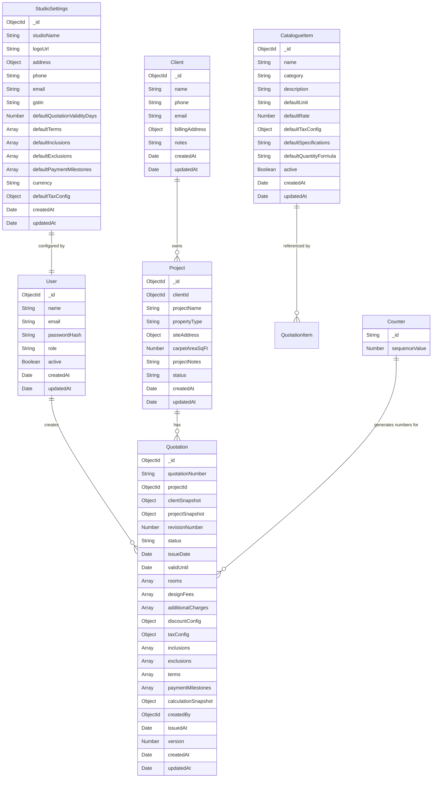

# The Space Story — Data Model

## Entity Relationship Diagram



## Detailed Schema Definitions

### User

```typescript
{
  name: string;              // Full name
  email: string;             // Unique, lowercase, indexed
  passwordHash: string;      // bcrypt hash, never exposed in API
  role: 'owner' | 'designer' | 'viewer';  // MVP: 'owner' only
  active: boolean;           // Soft-disable accounts
}
```

**Indexes:** `{ email: 1 }` (unique)

---

### StudioSettings

```typescript
{
  studioName: string;        // "The Space Story"
  logoUrl: string;           // Path or URL to logo
  address: {
    line1: string;
    line2?: string;
    city: string;
    state: string;
    pincode: string;
  };
  phone: string;
  email: string;
  gstin?: string;            // GST Identification Number
  defaultQuotationValidityDays: number;  // Default: 30
  defaultTerms: string[];
  defaultInclusions: string[];
  defaultExclusions: string[];
  defaultPaymentMilestones: Array<{
    description: string;
    percentage: number;       // Stored as integer (e.g., 40 for 40%)
  }>;
  currency: string;          // Default: "INR"
  defaultTaxConfig: {
    enabled: boolean;
    type: 'exclusive' | 'inclusive';
    rate: number;             // Percentage (e.g., 18)
    isInterState: boolean;
  };
}
```

**Notes:** Singleton document. Only one studio settings record exists.

---

### Client

```typescript
{
  name: string;              // Required
  phone?: string;
  email?: string;
  billingAddress?: {
    line1: string;
    line2?: string;
    city: string;
    state: string;
    pincode: string;
  };
  notes?: string;
}
```

**Indexes:** `{ name: 'text', email: 'text', phone: 'text' }` (text search)

---

### Project

```typescript
{
  clientId: ObjectId;        // Reference to Client, indexed
  projectName: string;
  propertyType?: 'apartment' | 'villa' | 'office' | 'retail' | 'other';
  siteAddress?: {
    line1: string;
    line2?: string;
    city: string;
    state: string;
    pincode: string;
  };
  carpetAreaSqFt?: number;
  projectNotes?: string;
  status: 'active' | 'completed' | 'on_hold' | 'cancelled';  // Default: 'active'
}
```

**Indexes:** `{ clientId: 1 }`, `{ status: 1 }`

---

### CatalogueItem

```typescript
{
  name: string;
  category: 'carpentry' | 'modular_kitchen' | 'furniture' | 'false_ceiling'
           | 'electrical' | 'plumbing' | 'civil_work' | 'painting'
           | 'flooring' | 'lighting' | 'furnishings' | 'design_services'
           | 'site_supervision' | 'other';
  description?: string;
  defaultUnit: 'sqft' | 'sqm' | 'running_ft' | 'running_m' | 'ft' | 'm'
              | 'piece' | 'set' | 'day' | 'hour' | 'visit' | 'lot'
              | 'fixed_amount';
  defaultRate: number;       // Stored in paise (integer)
  defaultTaxConfig?: {
    rate: number;
    type: 'exclusive' | 'inclusive';
  };
  defaultSpecifications?: string;
  defaultQuantityFormula?: 'manual' | 'length_x_width' | 'length_x_height'
                         | 'length_x_width_x_height' | 'count_x_per_unit';
  active: boolean;           // Default: true
}
```

**Indexes:** `{ category: 1 }`, `{ name: 'text', description: 'text' }`, `{ active: 1 }`

---

### Quotation

```typescript
{
  quotationNumber: string;   // e.g., "TSS-2026-0001"
  projectId: ObjectId;       // Reference to Project, indexed
  clientSnapshot: {          // Frozen copy of client data at issue time
    name: string;
    phone?: string;
    email?: string;
    billingAddress?: Address;
  };
  projectSnapshot: {         // Frozen copy of project data at issue time
    projectName: string;
    propertyType?: string;
    siteAddress?: Address;
    carpetAreaSqFt?: number;
  };
  revisionNumber: number;    // 1-based, incremented per revision
  status: 'draft' | 'issued' | 'approved' | 'rejected' | 'expired' | 'cancelled';
  issueDate?: Date;
  validUntil?: Date;
  rooms: Array<{
    roomId: string;          // UUID
    name: string;
    notes?: string;
    order: number;
    items: Array<{
      itemId: string;        // UUID
      catalogueItemId?: ObjectId;
      name: string;
      description?: string;
      specifications?: string;
      unit: string;
      quantity: number;
      dimensions?: {
        length?: number;
        width?: number;
        height?: number;
        count?: number;
        perUnit?: number;
      };
      rate: number;          // In paise
      taxConfig?: {
        rate: number;
        type: 'exclusive' | 'inclusive';
      };
      isOptional: boolean;
      isIncluded: boolean;   // For optional items: selected or not
      calculationMethod: 'manual' | 'length_x_width' | 'length_x_height'
                        | 'length_x_width_x_height' | 'count_x_per_unit';
      amount: number;        // In paise, calculated
      order: number;
    }>;
    subtotal: number;        // In paise, calculated
  }>;
  designFees: Array<{
    description: string;
    feeType: 'fixed' | 'percentage' | 'per_sqft';
    amount: number;          // In paise (for fixed/per_sqft) or percentage value
    calculatedAmount: number; // In paise, actual calculated amount
    isTaxable: boolean;
  }>;
  additionalCharges: Array<{
    description: string;
    amount: number;          // In paise
    isTaxable: boolean;
  }>;
  discountConfig: {
    type: 'none' | 'fixed' | 'percentage';
    value: number;           // Paise (fixed) or percentage
    calculatedAmount: number; // In paise
  };
  taxConfig: {
    enabled: boolean;
    type: 'exclusive' | 'inclusive';
    rate: number;            // Percentage
    isInterState: boolean;
  };
  inclusions: string[];
  exclusions: string[];
  terms: string[];
  paymentMilestones: Array<{
    description: string;
    percentage: number;
    amount: number;          // In paise, calculated
  }>;
  calculationSnapshot: {
    roomsSubtotal: number;   // In paise
    designFeesTotal: number;
    additionalChargesTotal: number;
    subtotalBeforeDiscount: number;
    discountAmount: number;
    subtotalAfterDiscount: number;
    taxableAmount: number;
    taxAmount: number;
    cgst?: number;
    sgst?: number;
    igst?: number;
    grandTotal: number;
  };
  previousRevisionId?: ObjectId;  // Link to prior revision
  createdBy: ObjectId;
  issuedAt?: Date;
  version: number;           // Optimistic concurrency control
}
```

**Indexes:**
- `{ quotationNumber: 1 }` (unique)
- `{ projectId: 1, revisionNumber: -1 }`
- `{ status: 1 }`
- `{ createdAt: -1 }`

---

### Counter

```typescript
{
  _id: string;              // e.g., "quotation_2026"
  sequenceValue: number;    // Atomically incremented
}
```

**Usage:** `findOneAndUpdate` with `$inc` and `upsert: true` for concurrency-safe numbering.

---

## Money Storage Convention

| Concept | Storage | Display |
|---------|---------|---------|
| Rate | Integer paise | ₹1,250.00 → stored as 125000 |
| Amount | Integer paise | ₹84,500.50 → stored as 8450050 |
| Percentage | Number | 18 (meaning 18%) |
| Rounding | Round half-up at line level | Applied before summing |

## Relationships Summary

| From | To | Type | Notes |
|------|-----|------|-------|
| Project | Client | Many-to-One | `clientId` FK |
| Quotation | Project | Many-to-One | `projectId` FK |
| Quotation | User | Many-to-One | `createdBy` FK |
| Quotation.items | CatalogueItem | Optional reference | `catalogueItemId` (for tracing, not live pricing) |
| Quotation | Quotation | Self-reference | `previousRevisionId` for revision chain |
